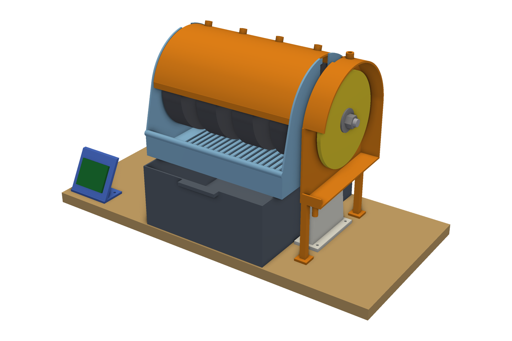

# 6-inch cabber: printable low-cost design

A cabber designed to be built from 3D prints and cheap, common parts: four 6 in wheels and a 6 in end disk. It has not been built yet, so the figures below are modeled or estimated, not measured. It is based on a friend's 3D-printed 6-inch cabber.

[Back](renders/assembly_back.png) · [hood off](renders/assembly_hood_off.png) · [exploded](renders/assembly_exploded.png) · prints: [cad/README.md](cad/README.md) · parts: [BOM.md](BOM.md) · build: [ASSEMBLY.md](ASSEMBLY.md) · wiring: [WIRING.md](WIRING.md)

| | |
|---|---|
| Parts to buy | **$80** ([BOM.md](BOM.md)), plus wheels |
| Prints | 17 parts (23 pieces), estimated ~2.4 kg PETG and ~68 h |
| Stations | 4 × 6 × 1½ in wheels + 6 in hook-and-loop end disk |
| Speed | 0 to ~1,500 RPM at the arbor (computed from the belt ratio), set with a knob |

## How it works

- **Arbor: one 1/2-13 × 14 in hex bolt.** Its head sits in a hex pocket in the printed pulley, so the pulley turns the bolt with no set screws. One nut at the far end clamps everything: pulley, bearing, spacer, four wheels on printed bushings, spacer, bearing, end disk. Snug the nut (about 5 N·m) and re-snug after the first hour.
- **Bearings:** two R8 bearings (1/2 in bore) in printed pedestals with screw-down caps, wood-screwed to a pine board. Lift off the caps and the whole arbor comes out for wheel changes.
- **Drive:** a 775 DC motor on 12 V, run through a PWM speed-control board, drives a 3D-printer GT2 belt. The arbor pulley is printed; its tooth count is computed from the motor speed so full speed is about 1,500 RPM (20T : 53T for a 4,000 RPM motor; the model is checked for that motor only). Slide the motor cradle back to tension the belt.
- **Water:** a 12 V mini pump in the printed tank, behind a built-in weir, feeds airline drips to each wheel through cheap airline valves. Slurry drains through the slotted pan into the front of the tank and settles. Use a squeeze bottle on the end disk, so polishing doesn't get grit from the coarse wheels.
- **Splash:** a lift-off printed hood over the wheels; a pan with a 40 mm front lip that doubles as an arm rest; an arched shroud over the end disk that drains into a cup.

## Numbers

| | |
|---|---|
| Bearing span | 281 mm. Estimate: under a 50 N stone load the bolt bends ~0.09 mm, and its first critical speed is above 3,500 RPM. This treats the bolt as a simply supported 1/2 in steel beam (E = 200 GPa) with the load at midspan, ignores the stiffening from wheels and spacers, and holds for up to about 4 kg of rotating mass lumped at midspan. |
| Wheel gaps | 31 mm |
| Arbor height | 228 mm above the bench |
| Belt | GT2 6 mm, 500 mm loop, motor ~111 mm behind the arbor |

## Stations

| Station | Grit | RPM |
|---|---|---|
| W1 | 80 hard | 1,000–1,500 |
| W2 | 220 hard | 1,000–1,500 |
| W3 | 280 resin | 800–1,200 |
| W4 | 600 resin | 800–1,200 |
| End disk | 1,200 → 8,000 pads, then oxide on felt | 300–1,000 |

Wheel tops turn **toward you**; if not, swap the motor's two wires. Dress hard wheels with a silicon-carbide stick when they glaze. For soft stones, skip the 80.

## Limits of a cheap build

- A 775 motor is light. Use moderate pressure. Run the motor on 12 V only: the pump shares the supply, and the model is checked for the 4,000 RPM speed.
- The printed spacers that bear on the bearing races are printed solid. If one squashes over time, a stub of 1/2 in copper pipe does the same job.
- Imported wheels can run a little out of round. Dress them true on the machine.
