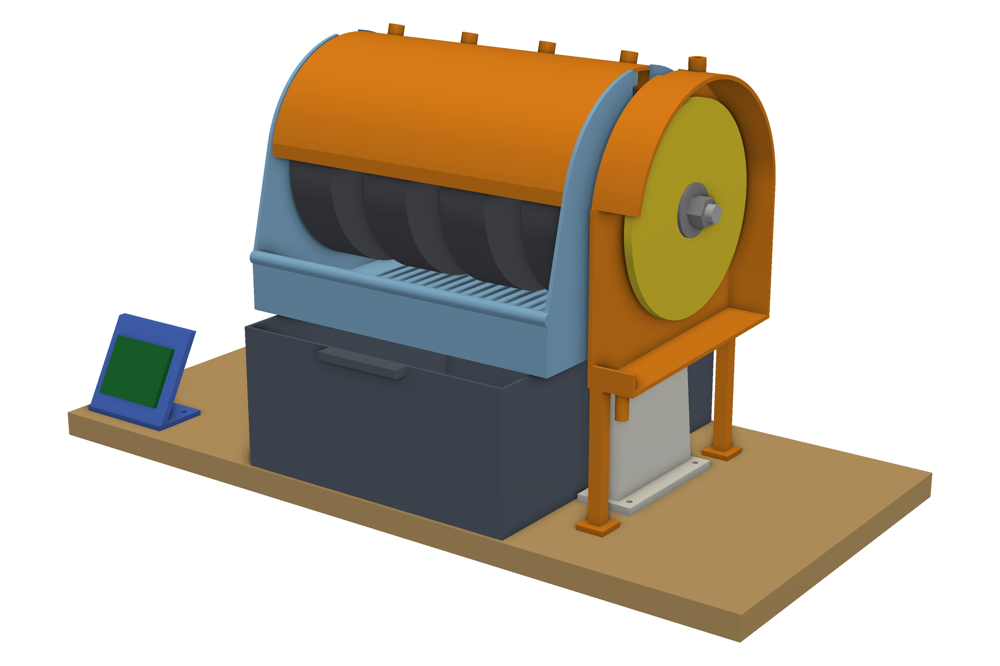

# Printable cabber

> **Not built or tested.** This is a design only. No machine has been built from these files, nothing in it has been tested, and it may not work as designed. Use it at your own risk.

A 6-inch cabbing machine for shaping and polishing stones, designed to be built from 3D prints and common new parts. Four grinding wheels and a polishing disk sit on one hardware-store hex bolt, driven by a 775 motor with a PWM speed knob and a GT2 belt, with a 12 V pump feeding water to each wheel. One CadQuery script builds the 17 printed parts (23 pieces, counting repeats), and a second script checks the assembled machine for interference, running clearance and printability.



The parts cost about $80, or $233 with wheels, pads and a dressing stick. The cheapest new machine with four or more wheels is about $840 ([BUY-VS-BUILD.md](BUY-VS-BUILD.md)).

## Status

This is a design. The model builds and the checks below pass. I have not built the machine from these files, so the printed parts have not been tested under load and every fit is as modeled. Most small-part prices in the bill of materials are estimates, and the listed prices were checked on 2026-10-22.

Safety: this design is untested. Wear eye protection when you cut stone. The printed hood is a splash guard, not a safety guard.

What works:

- `cad/cabber.py` builds the 17 printed parts as valid, single-solid, watertight STLs, plus STEP files and renders.
- `cad/check_clashes.py` finds no overlap between any two bodies, using two independent engines, and confirms that moving parts keep their required clearance.
- The bolt stack fits the 14 in bolt.

What is unfinished or unproven:

- There is no physical build, so there are no measured speed, vibration or splash results.
- The belt teeth are modeled as a small overlap with the pulley grooves, and the checker allows it.
- Print times and masses in [cad/README.md](cad/README.md) are planning estimates. Use your slicer's numbers.

## Known issues

Some clearances in the model are tight for FDM printing. If parts rub, file them or reprint with a slightly larger gap.

| Pair | Modeled gap |
|---|---|
| Hood to the pan's two hood ledges | 0.3 mm (resting contact) |
| Bearing cap to pan | 0.5 mm |
| Spacer faces to pan and shroud | 1.5 mm |
| Arbor pulley to left pedestal | 1.97 mm |

The hood also rests against the pan's back wall by design, so those two touch. The checker requires 5 mm for the wheels and the end disk, and smaller gaps for other moving parts. See `required_gap` in [cad/check_clashes.py](cad/check_clashes.py).

## Requirements

- Python 3.12. The pinned versions in `requirements.txt` were run on Windows 10 only; Linux and macOS are untested.
- About 1.2 GB of disk for the packages. CadQuery's OpenCascade kernel and VTK are large.
- To print: the parts were checked against a 420 × 420 mm bed. The longest part on the bed is the disk shroud at 310 mm, and the tallest is the hood at 255 mm. The prints take about 2.4 kg of PETG and roughly 68 hours.

## Build and run

```text
python -m venv .venv
.venv\Scripts\activate            # macOS or Linux: source .venv/bin/activate
pip install -r requirements.txt
python cad/cabber.py              # STLs, STEPs and renders; add --no-render to skip the renders
```

Only one configuration has passed the checks: a 4,000 RPM motor, a 14 in bolt and 1½ in wheels. The parameters at the top of `cad/cabber.py` (`motor_rpm`, `wheel_w`, `bolt_len_in` and others) can be changed, but other values are untested and some fail the check. A 12 in bolt and 6,000 or 8,000 RPM motors do. Run `python cad/check_clashes.py` after any change.

Running `cad/cabber.py` rewrites the files in `cad/stl/`, `cad/step/` and `renders/`, and `cad/print_table.json`. The STLs and renders come out identical, but each STEP file gets a new timestamp in its header, so git shows them as changed. To build the machine, read [DESIGN.md](DESIGN.md), buy from [BOM.md](BOM.md), print as described in [cad/README.md](cad/README.md), and follow [ASSEMBLY.md](ASSEMBLY.md) and [WIRING.md](WIRING.md).

## Tests

```text
python cad/check_clashes.py
```

It exits 0 when everything passes, 1 when it finds a problem and 2 when the check itself could not run. It checks that:

- every body is one valid solid, the printed counts match the print list, and the STEP assembly matches the model;
- every STL is current, watertight and fits the bed;
- no two bodies overlap, tested with OpenCascade's exact boolean and with manifold3d on meshes, and a disagreement between the two counts as a failure;
- moving parts keep their clearance: 5 mm for wheels and the end disk, 1 mm for other rotating parts, 2 mm for the belt and 3 mm for the sliding tank;
- the checker catches deliberate mistakes (a dropped hood, a wheel pushed at the pan, an empty body) before it judges the model.

## Files

| Read | For |
|---|---|
| [DESIGN.md](DESIGN.md) | How it works |
| [BOM.md](BOM.md) | What to buy, with links and prices |
| [cad/README.md](cad/README.md) | STLs and print settings |
| [ASSEMBLY.md](ASSEMBLY.md) | Build steps |
| [WIRING.md](WIRING.md) | Four wires |
| [BUY-VS-BUILD.md](BUY-VS-BUILD.md) | $233 with wheels against $840 or more to buy |

`tools/bom.py` regenerates `BOM.md` from its parts list, and `tools/print_table.py` refreshes the print table in `cad/README.md`.

## Data sources

There are no datasets. Prices in `BOM.md` and `BUY-VS-BUILD.md` come from public retail and manufacturer listings seen on 2026-10-22 and will have changed. The links go to those listings.

## Credits

The design is based on a friend's 3D-printed 6-inch cabber. No files, models or photos from that machine are included here.

It is built with [CadQuery](https://github.com/CadQuery/cadquery) (Apache-2.0) on the OpenCascade kernel, [manifold3d](https://github.com/elalish/manifold) (Apache-2.0), [trimesh](https://trimesh.org) (MIT), [Shapely](https://github.com/shapely/shapely) (BSD-3-Clause), and [PyVista](https://github.com/pyvista/pyvista) with VTK (MIT and BSD-3-Clause) for the renders.

## License

MIT. See [LICENSE](LICENSE).
